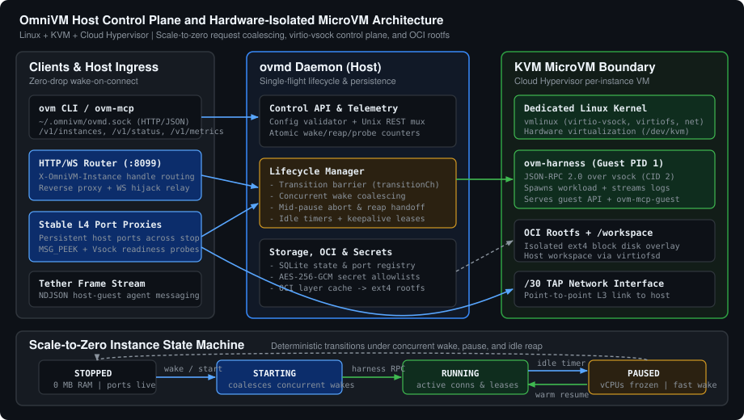

# OmniVM

[](https://github.com/SalyyS1/omnivm/actions/workflows/ci.yml)
[](https://github.com/SalyyS1/omnivm/releases)
[](LICENSE)

Hardware-isolated, scale-to-zero Linux microVMs for AI sandboxes, ephemeral tool execution, and on-demand services.

OmniVM runs each workload inside a dedicated [Cloud Hypervisor](https://github.com/cloud-hypervisor/cloud-hypervisor) microVM backed by Linux KVM and its own guest kernel. Any standard OCI container image (`python:3.12-alpine`, `node:22-alpine`, `ubuntu:24.04`, or custom registries) is unpacked and formatted into an isolated `ext4` root block device. Idle microVMs automatically freeze vCPUs (`PAUSED`) and later scale down to zero host memory (`STOPPED`), while keeping host ingress ports bound so the next HTTP request, TCP connection, `exec` call, or agent tether frame transparently wakes the instance.

> **Status: pre-alpha.** OmniVM builds upon [AegisVM](https://github.com/xfeldman/aegisvm) and is actively hardened toward multi-tenant Linux deployments. Host-level multi-tenant network isolation (`nftables` anti-spoofing), cgroup v2 quotas, and unprivileged VMM sandboxing are tracked on the [roadmap](#roadmap); do not expose untrusted multi-tenant workloads on shared production hosts without additional host isolation. Benchmark claims are published together with reproducible scripts in [docs/benchmarks.md](docs/benchmarks.md).

## Architecture

<p align="center">
  
</p>

OmniVM separates host control-plane state, ingress routing, and hardware virtualization across five static Go binaries:

| Binary | Side | Responsibility |
|---|---|---|
| `ovm` | Host | Command-line interface communicating with `ovmd` over `~/.omnivm/ovmd.sock` (`--json` supported for automation). |
| `ovmd` | Host | Control-plane daemon: configuration validation, scale-to-zero lifecycle state machine, HTTP/TCP ingress router, SQLite registry, and AES-256-GCM secret store. |
| `ovm-harness` | Guest (PID 1) | Static Linux guest init: mounts `proc`/`sys`/`dev` and `virtiofs` workspaces, speaks JSON-RPC 2.0 to `ovmd` over `virtio-vsock` (CID 2), supervises guest processes, and serves the guest orchestration API. |
| `ovm-mcp` | Host | Model Context Protocol (MCP) server exposing sandbox creation, execution, workspace I/O, and tether messaging to host LLM agents. |
| `ovm-mcp-guest` | Guest | In-guest MCP bridge enabling sandboxed agents to spawn capability-scoped child microVMs via `ovm-harness`. |

## Scale-to-Zero Lifecycle and Concurrency Guarantees

Every serve-mode instance is governed by a deterministic four-state machine inside `internal/lifecycle`:

```text
STOPPED  --->  STARTING  --->  RUNNING  <===>  PAUSED
   ^                              |               |
   +----------- (disable/exit) ---+--- (reaper) --+
```

1. **`STOPPED` (0 MB VM RAM)**: No hypervisor process is running. Instance metadata, secret allowlists, and allocated public TCP port mappings remain persisted in SQLite (`ovmd.db`), and host port proxies stay bound on `127.0.0.1:<public_port>`.
2. **`STARTING` (Cold Boot)**: Triggered on demand by `EnsureInstance` (HTTP request on `:8099`, L4 TCP connection on an exposed port, `ovm exec`, or tether frame). `ovmd` prepares the OCI `ext4` rootfs overlay, resolves secret allowlists into ephemeral boot memory, spawns Cloud Hypervisor + `virtiofsd`, establishes the `virtio-vsock` JSON-RPC channel to `ovm-harness`, and launches the guest command.
3. **`RUNNING` (Active)**: Guest workload serves traffic. Active TCP/HTTP connections (`activeConns > 0`) and guest keepalive leases suppress idle timers. Once connections drain, `PauseAfterIdle` (default `60s`) arms.
4. **`PAUSED` (Warm Standby)**: vCPUs are frozen via Cloud Hypervisor while guest RAM stays resident, enabling sub-second warm resume (`ResumeVM`) on the next inbound packet. After `StopAfterIdle` (default `20m`), the idle reaper stops the VMM and returns the instance to `STOPPED`.

### Hardened Wake, Pause, and Reaper Synchronization

Scale-to-zero proxies routinely encounter thundering-herd wake storms and boundary races when traffic arrives mid-shutdown. OmniVM enforces three concurrency invariants verified under `go test -race ./...`:

- **Zero-Polling Single-Flight Coalescing**: Concurrent callers hitting a `STOPPED`, `STARTING`, or `PAUSED` instance synchronize on a per-instance broadcast channel (`transitionCh`) rather than polling timers. Only the leader goroutine invokes `StartVM` or `ResumeVM`; all concurrent HTTP, TCP, `exec`, and tether callers wake on channel close as soon as the transition completes (`coalesced_wakes`).
- **Mid-Pause Activity Abort**: Because hypervisor `PauseVM` RPCs execute outside the instance mutex, a new request or lease can arrive while `PauseVM` is in flight. `ovmd` marks `pausing = true`, re-checks `activeConns`, `leaseHeld`, and `transitionCh` immediately upon return, and aborts the pause via an immediate `ResumeVM` (`aborted_pauses`) before notifying waiting callers.
- **Wake-During-Reap Handoff**: When `StopAfterIdle` expires and the reaper begins tearing down a paused VM (`demux.Stop()` + `StopVM`), `reaping = true` serializes teardown against incoming wakes. Concurrent requests arriving mid-reap block cleanly on `transitionCh` until `StopVM` releases hypervisor resources, then execute a single coordinated cold boot (`reap_wake_handoffs`) instead of racing against a dying VMM socket.

### TCP and Virtio-Vsock Readiness Probes

After a cold boot or warm resume, the VM kernel may be up milliseconds before the guest process finishes binding its listening socket:

- **Context-Aware TCP Probing (`router.ProbeTCP`)**: Uses bounded exponential backoff (`20ms` up to `200ms`) with request-context cancellation and a non-destructive `recvfrom(..., MSG_PEEK | MSG_DONTWAIT)` socket check to reject immediate-EOF proxy accepts before relaying client bytes.
- **Single-Byte Vsock Handshake (`router.ProbeVsock`)**: Validates guest `virtio-vsock` readiness through Cloud Hypervisor's host Unix multiplexer socket (`CONNECT <port>\n` -> `OK <local_port>\n`), reading the response header one byte at a time so zero guest application payload bytes are ever consumed by a buffered reader.

## Quick Start

### Prerequisites

- Linux (`x86_64` or `aarch64`) with `/dev/kvm` available
- Go `1.25+` (to build from source)
- Host packages: `virtiofsd`, `e2fsprogs`, `iptables`, `iproute2`

```bash
sudo apt-get update
sudo apt-get install -y virtiofsd e2fsprogs iptables iproute2

git clone https://github.com/SalyyS1/omnivm.git
cd omnivm

# Download Cloud Hypervisor static binary, guest kernel (vmlinux), and build all 5 Go binaries
make cloud-hypervisor kernel all

# Start the ovmd control plane daemon
./bin/ovm up

# Verify host platform, KVM, virtiofsd, kernel, and daemon capabilities
./bin/ovm doctor
```

## CLI Usage

### 1. Ephemeral AI / Code Execution Sandbox

`ovm run` boots a fresh microVM from an OCI image, streams structured logs until the process exits, and deletes both the VM and temporary workspace automatically:

```bash
./bin/ovm run --image python:3.12-alpine -- python3 -c "import platform; print(platform.uname())"

# Mount a persistent host directory at /workspace inside the guest
./bin/ovm run --workspace ./my-project --image node:22-alpine -- node /workspace/index.js
```

### 2. Persistent Scale-to-Zero Services and Wake-on-Connect

```bash
# Start a named HTTP service inside a microVM
./bin/ovm instance start --name api-svc --image python:3.12-alpine -- python3 -m http.server 8080

# Allocate a stable host TCP port mapped to guest port 8080 (survives pause and stop)
./bin/ovm instance expose api-svc 18080:8080/http

# Pause or let the instance scale to zero; curling either endpoint wakes it automatically
./bin/ovm instance pause api-svc
curl -H "X-OmniVM-Instance: api-svc" http://127.0.0.1:8099/
curl http://127.0.0.1:18080/
```

### 3. Encrypted Secrets with Explicit Allowlists

Secrets are encrypted at rest with AES-256-GCM (`~/.omnivm/master.key`) and are never baked into disk images or SQLite env columns; `ovmd` decrypts only allowlisted keys into memory on each boot:

```bash
./bin/ovm secret set OPENAI_API_KEY "sk-..."
./bin/ovm instance start --name agent --secret OPENAI_API_KEY -- python3 /workspace/agent.py
```

### 4. Structured JSON Status and Telemetry

Both the CLI and Unix-socket REST API expose structured JSON status and atomic lifecycle/router telemetry:

```bash
./bin/ovm status --json
./bin/ovm instance list --json
```

## Control-Plane HTTP API (`~/.omnivm/ovmd.sock`)

Automation tools can query `ovmd` directly over its Unix domain socket:

```bash
curl --unix-socket ~/.omnivm/ovmd.sock http://ovm/v1/metrics
```

Example `GET /v1/metrics` response:

```json
{
  "timestamp": "2026-11-14T06:30:00Z",
  "version": "v0.2.0",
  "backend": "cloud-hypervisor",
  "uptime_seconds": 3420,
  "instances": {
    "total": 4,
    "running": 1,
    "starting": 0,
    "paused": 1,
    "stopped": 2,
    "disabled": 0
  },
  "lifecycle": {
    "cold_starts": 6,
    "boot_failures": 0,
    "warm_resumes": 19,
    "coalesced_wakes": 42,
    "reap_wake_handoffs": 2,
    "idle_pauses": 18,
    "aborted_pauses": 1,
    "idle_stops": 5,
    "active_connections": 3
  },
  "router": {
    "active_port_proxies": 3,
    "http_requests": 1284,
    "tcp_connections": 96,
    "probe_retries": 14,
    "backend_errors": 0
  }
}
```

Key REST endpoints:

- `GET /v1/status` - Daemon health, backend capabilities, instance counts, and lifecycle summary
- `GET /v1/metrics` - Timestamped lifecycle, request-coalescing, and router probe telemetry
- `POST /v1/instances` / `GET /v1/instances` / `DELETE /v1/instances/{id}` - Instance lifecycle CRUD
- `POST /v1/instances/{id}/exec` - Wake-on-exec command runner streaming NDJSON stdout/stderr + exit code
- `POST /v1/instances/{id}/expose` / `DELETE /v1/instances/{id}/expose/{guest_port}` - Dynamic L4/HTTP port publishing
- `POST /v1/instances/{id}/tether` / `GET /v1/instances/{id}/tether/stream` - Host-guest agent frame bus
- `PUT /v1/secrets/{name}` / `GET /v1/secrets` / `DELETE /v1/secrets/{name}` - Encrypted secret management

## Testing

Unit, configuration validation, router readiness-probe, HTTP API, and race-detector concurrency suites run on standard Linux runners without requiring `/dev/kvm`:

```bash
go test -race -v ./...
```

Full end-to-end Cloud Hypervisor boot, `virtiofs` workspace, and network integration tests (requires `/dev/kvm` and root):

```bash
sudo make integration
```

## Documentation

- [Quickstart Guide](docs/QUICKSTART.md)
- [CLI Reference](docs/CLI.md)
- [Ingress Router and Wake-on-Connect](docs/ROUTER.md)
- [Guest Orchestration API](docs/GUEST_API.md)
- [Tether Messaging Protocol](docs/TETHER.md)
- [Encrypted Secrets](docs/SECRETS.md)
- [Virtiofs Workspaces](docs/WORKSPACES.md)
- [Troubleshooting](docs/TROUBLESHOOTING.md)
- [Benchmarks Methodology](docs/benchmarks.md)
- [Development Environment](docs/development-environment.md)

## Roadmap

1. **Reproducible Benchmarks and Config Hardening**: Automated KVM benchmarks, rootfs image-layer sizing, and strict daemon configuration validation.
2. **Multi-Tenant Network Isolation**: `nftables` rule sets replacing shell `iptables`, `/30` subnet pooling, anti-spoofing filters, and VM-to-VM deny policies.
3. **Resource Quotas and CoW Storage**: `reflink` / `dm-thin` copy-on-write instance disks, per-VM cgroup v2 CPU/memory limits, and block I/O throttling.
4. **Daemonless VM Survival**: Unprivileged Cloud Hypervisor jails and live state re-attachment across `ovmd` upgrades.
5. **Disk Snapshots on Idle**: Memory snapshot-to-disk hibernation with guest clock resynchronization and virtio-rng entropy reseeding on restore.

## Attribution and License

OmniVM is a fork of [AegisVM](https://github.com/xfeldman/aegisvm) by Max Feldman and the AegisVM contributors, distributed under the [Apache License 2.0](LICENSE). See [NOTICE](NOTICE) for upstream attribution and a summary of architectural changes.
