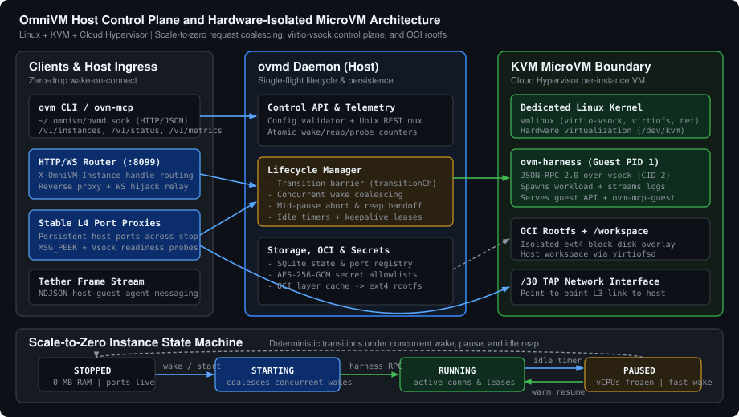

# OmniVM

[](https://github.com/SalyyS1/omnivm/actions/workflows/ci.yml)
[](https://github.com/SalyyS1/omnivm/releases)
[](https://salyys1.github.io/omnivm/)
[](LICENSE)

Hardware-isolated, scale-to-zero Linux microVMs for AI sandboxes, ephemeral tool execution, and on-demand services. Explore the interactive state-machine, wake-coalescing, and quota simulator at [salyys1.github.io/omnivm](https://salyys1.github.io/omnivm/).

OmniVM runs each workload inside a dedicated [Cloud Hypervisor](https://github.com/cloud-hypervisor/cloud-hypervisor) microVM backed by Linux KVM and its own guest kernel. Any standard OCI container image (`python:3.12-alpine`, `node:22-alpine`, `ubuntu:24.04`, or custom registries) is unpacked and formatted into an isolated `ext4` root block device. Idle microVMs automatically freeze vCPUs (`PAUSED`) and later scale down to zero host memory (`STOPPED`), while keeping host ingress ports bound so the next HTTP request, TCP connection, `exec` call, or agent tether frame transparently wakes the instance.

> **Release: v1.0.0.** OmniVM builds upon [AegisVM](https://github.com/xfeldman/aegisvm) with unprivileged subordinate UID/GID VMM jails (`OVM-JAIL-001..008`), daemonless survival leases across `ovmd` upgrades, sparse zero-page memory hibernation with guest clock resynchronization and `virtio-rng` entropy reseeding, Copy-on-Write branching, Virtio-FS/PMEM DAX pooling, and per-tenant egress CIDR/DNS firewalling. Benchmark claims are published together with reproducible scripts in [docs/benchmarks.md](docs/benchmarks.md).

## Architecture

<p align="center">
  
</p>

OmniVM separates host control-plane state, ingress routing, and hardware virtualization across five static Go binaries:

| Binary | Side | Responsibility |
|---|---|---|
| `ovm` | Host | Command-line interface communicating with `ovmd` over `~/.omnivm/ovmd.sock` (`--json` supported for automation). |
| `ovmd` | Host | Control-plane daemon: configuration validation, scale-to-zero lifecycle state machine, HTTP/TCP ingress router, SQLite registry, and AES-256-GCM secret store. |
| `ovm-harness` | Guest (PID 1) | Static Linux guest init: mounts `proc`/`sys`/`dev` and `virtiofs` workspaces, speaks JSON-RPC 2.0 to `ovmd` over `virtio-vsock` (CID 2), supervises guest processes, and serves the guest orchestration API. |
| `ovm-mcp` | Host | Model Context Protocol (MCP) server exposing sandbox creation, execution, workspace I/O, and tether messaging to host LLM agents. |
| `ovm-mcp-guest` | Guest | In-guest MCP bridge enabling sandboxed agents to spawn capability-scoped child microVMs via `ovm-harness`. |

## Scale-to-Zero Lifecycle and Concurrency Guarantees

Every serve-mode instance is governed by a deterministic four-state machine inside `internal/lifecycle`:

```text
STOPPED  --->  STARTING  --->  RUNNING  <===>  PAUSED
   ^                              |               |
   +----------- (disable/exit) ---+--- (reaper) --+
```

1. **`STOPPED` (0 MB VM RAM)**: No hypervisor process is running. Instance metadata, secret allowlists, and allocated public TCP port mappings remain persisted in SQLite (`ovmd.db`), and host port proxies stay bound on `127.0.0.1:<public_port>`.
2. **`STARTING` (Cold Boot)**: Triggered on demand by `EnsureInstance` (HTTP request on `:8099`, L4 TCP connection on an exposed port, `ovm exec`, or tether frame). `ovmd` prepares the OCI `ext4` rootfs overlay, resolves secret allowlists into ephemeral boot memory, spawns Cloud Hypervisor + `virtiofsd`, establishes the `virtio-vsock` JSON-RPC channel to `ovm-harness`, and launches the guest command.
3. **`RUNNING` (Active)**: Guest workload serves traffic. Active TCP/HTTP connections (`activeConns > 0`) and guest keepalive leases suppress idle timers. Once connections drain, `PauseAfterIdle` (default `60s`) arms.
4. **`PAUSED` (Warm Standby)**: vCPUs are frozen via Cloud Hypervisor while guest RAM stays resident, enabling sub-second warm resume (`ResumeVM`) on the next inbound packet. After `StopAfterIdle` (default `20m`), the idle reaper stops the VMM and returns the instance to `STOPPED`.

### Hardened Wake, Pause, and Reaper Synchronization

Scale-to-zero proxies routinely encounter thundering-herd wake storms and boundary races when traffic arrives mid-shutdown. OmniVM enforces three concurrency invariants verified under `go test -race ./...`:

- **Zero-Polling Single-Flight Coalescing**: Concurrent callers hitting a `STOPPED`, `STARTING`, or `PAUSED` instance synchronize on a per-instance broadcast channel (`transitionCh`) rather than polling timers. Only the leader goroutine invokes `StartVM` or `ResumeVM`; all concurrent HTTP, TCP, `exec`, and tether callers wake on channel close as soon as the transition completes (`coalesced_wakes`).
- **Mid-Pause Activity Abort**: Because hypervisor `PauseVM` RPCs execute outside the instance mutex, a new request or lease can arrive while `PauseVM` is in flight. `ovmd` marks `pausing = true`, re-checks `activeConns`, `leaseHeld`, and `transitionCh` immediately upon return, and aborts the pause via an immediate `ResumeVM` (`aborted_pauses`) before notifying waiting callers.
- **Wake-During-Reap Handoff**: When `StopAfterIdle` expires and the reaper begins tearing down a paused VM (`demux.Stop()` + `StopVM`), `reaping = true` serializes teardown against incoming wakes. Concurrent requests arriving mid-reap block cleanly on `transitionCh` until `StopVM` releases hypervisor resources, then execute a single coordinated cold boot (`reap_wake_handoffs`) instead of racing against a dying VMM socket.
- **Host Resource Admission Quotas and LRU Paused Eviction**: Operators can cap host-wide resident guest RAM (`OVM_MAX_HOST_MEMORY_MB`), active virtual CPUs (`OVM_MAX_ACTIVE_VCPUS`), and concurrent active microVMs (`OVM_MAX_ACTIVE_VMS`). Before rejecting a cold boot for memory pressure, `ovmd` automatically evicts the least-recently-used idle `PAUSED` microVMs (`paused_evictions`) to reclaim host RAM while keeping newer standbys warm. When active (`STARTING` + `RUNNING`) capacity alone hits a configured ceiling, `ovmd` rejects over-admission with `HTTP 429 Too Many Requests` (`quota_rejections`) across HTTP ingress, wake-on-exec, tether ingress, and nested `guest.spawn` calls.

### TCP and Virtio-Vsock Readiness Probes

After a cold boot or warm resume, the VM kernel may be up milliseconds before the guest process finishes binding its listening socket:

- **Context-Aware TCP Probing (`router.ProbeTCP`)**: Uses bounded exponential backoff (`20ms` up to `200ms`) with request-context cancellation and a non-destructive `recvfrom(..., MSG_PEEK | MSG_DONTWAIT)` socket check to reject immediate-EOF proxy accepts before relaying client bytes.
- **Single-Byte Vsock Handshake (`router.ProbeVsock`)**: Validates guest `virtio-vsock` readiness through Cloud Hypervisor's host Unix multiplexer socket (`CONNECT <port>\n` -> `OK <local_port>\n`), reading the response header one byte at a time so zero guest application payload bytes are ever consumed by a buffered reader.

## Snapshot Branching, Copy-on-Write Overlays, and KSM Memory Deduplication

AI evaluation harnesses and speculative code-execution pipelines frequently fork multiple isolated sandboxes from a shared golden environment. OmniVM `v0.4.0` eliminates full-disk copies and duplicate guest RAM across branches:

- **Point-in-Time Quiescent Snapshots (`CreateSnapshot`)**: Captures an instance's `ext4` root block device, `/workspace` directory tree, and optional Cloud Hypervisor `vm.snapshot` state under an exclusive transition freeze (`freezeInstanceForClone`). Running microVMs are transiently paused during cloning and resumed immediately without dropping bound host ports.
- **Copy-on-Write Reflink and Sparse Extent Cloning (`overlay.CloneFileCoW` / `CloneTreeCoW`)**: On reflink-capable Linux filesystems (`XFS`, `Btrfs`, `bcachefs`), root disks and workspace files are cloned in $O(1)$ time via the `FICLONE` `ioctl`, sharing physical extents Copy-on-Write until mutated. On `ext4` or `tmpfs`, OmniVM automatically falls back to 64 KiB sparse extent scanning (`Seek` hole preservation), keeping sparse `.ext4` block images thin on disk (`cow_saved_bytes`).
- **Speculative MicroVM Branching (`BranchInstance`)**: Branches can be spawned from a named snapshot (`POST /v1/snapshots/{id}/branch` / `ovm snapshot branch`) or directly from a live/paused/stopped instance (`POST /v1/instances/{id}/branch` / `ovm instance branch`), with optional command, environment, resource, and `start=false` (0 MB RAM lazy wake-on-request) overrides. Also exposed to LLM agents via `ovm-mcp` tools (`snapshot_create`, `snapshot_list`, `snapshot_delete`, `instance_branch`).
- **Zero-Overhead Memory Deduplication (`internal/ksm` + `MADV_MERGEABLE`)**: When `OVM_MEMORY_DEDUP=true` (default) and `virtiofs` shared DMA is not attached, Cloud Hypervisor marks anonymous guest RAM `mergeable=on` (`MADV_MERGEABLE`). The adaptive KSM governor (`OVM_KSM_GOVERNOR=auto`) keeps `ksmd` paused (`run=0`, 0% background CPU overhead while retaining already-merged CoW pages) whenever fewer than 2 microVMs hold resident RAM, activates `ksmd` (`run=1`, `50ms` ramp) when 2 or more microVMs are resident, and backs off to steady-state (`200ms`) once page sharing stabilizes.

## Zero-Network Virtio-Vsock Multiplexing, Cgroup v2 Watermarks, and Warm-Pool Pre-Faulting (`v0.6.0`)

- **Binary-Framed Virtio-Vsock Stream Multiplexer (`internal/vsockmux`)**: Multiplexes concurrent full-duplex `net.Conn` streams (`OpenStream`, `AcceptStream`, `CloseWrite`, `Reset`, `Ping`, `GoAway`) over a single `AF_VSOCK` or Cloud Hypervisor host Unix vsock socket (`DialCloudHypervisorVsock`). Uses a 10-byte wire header and per-stream 256 KiB sliding credit windows (`FrameWindowUpdate`) so airgapped (`--no-network`) sandboxes stream stdio, RPC, and binary blobs without TCP/IP interfaces or cross-stream head-of-line blocking.
- **Dynamic Linux Cgroup v2 `memory.high` Watermark Governor (`internal/cgroup`)**: Reads `memory.current`, `memory.high`, `memory.max`, `memory.events` (`high` soft-throttle direct-reclaim counts and `oom`/`oom_kill` events), and Linux PSI (`memory.pressure` `some`/`full` stall ratios). When `OVM_CGROUP_GOVERNOR=adaptive`, `ovmd` tightens `memory.high` on hard-limit breaches so kernel direct reclaim engages before OOM kills, relaxes `memory.high` under severe PSI `full` stalls when headroom exists, and exposes `omnivm_cgroup_*` Prometheus/OpenMetrics series.
- **Automated Warm-Pool Page Pre-Faulting and Benchmark (`internal/prefault` + `ovm bench prefault`)**: Populates anonymous guest memory pools and `mmap` snapshot images ahead of wake via Linux `MADV_POPULATE_WRITE` / `MADV_POPULATE_READ` (`MADV_WILLNEED` + parallel page-stride worker fallback), eliminating first-touch minor page faults (`minflt=0` on warm slots) and exposing `ovm bench prefault [--json]` plus `POST /v1/bench/prefault`.
- **Live MicroVM Migration and Per-VM Network Namespace Isolation (`internal/migration`, `internal/netns`)**: Iterative dirty-bitmap pre-copy and optional post-copy live migration (`POST /v1/instances/{id}/migrate`, `ovm instance migrate`) alongside isolated `/run/netns/ovm-<id>` veth pairs with `/30` subnet allocation.

## Proactive KSM Governor, Disk-Cache Pre-Warming, and Wake Latency Histograms (`v0.7.0`)

- **Proactive KSM Memory Governor (`internal/ksm`)**: Extends kernel samepage deduplication with fleet-density burst scaling (`OVM_KSM_GOVERNOR=proactive`). Pre-indexes guest memory pages on cold-boot and branch spawn events (`NotifySpawn`), scales `pages_to_scan` dynamically with active VM count (up to 2048 pages per 20ms burst), pins NUMA socket-local deduplication (`merge_across_nodes=0`), and automatically throttles scan intervals to 500ms when volatile heap page churn exceeds 50%.
- **Sparse-Extent Disk-Cache Pre-Warming (`internal/diskwarm`)**: Pre-warms guest kernel images (`vmlinux`) and rootfs extents ahead of cold boot (`OVM_DISK_PREWARM=auto|eager|off`). Discovers allocated blocks via `SEEK_DATA`/`SEEK_HOLE` in O(1) time to bypass gigabytes of unallocated sparse holes, issuing `POSIX_FADV_WILLNEED` exclusively against physical blocks within a bounded budget (`OVM_DISK_PREWARM_BUDGET_MB`).
- **Prometheus 0.0.4 and OpenMetrics 1.0.0 Wake Latency Histograms (`internal/telemetry`)**: Implements thread-safe cumulative latency histograms for `cold_boot`, `warm_resume`, and `coalesced_wait` transitions (`omnivm_wake_latency_seconds`), plus cumulative counters for page-cache pre-warming and proactive KSM scan efficiency.

## Quick Start

### Prerequisites

- Linux (`x86_64` or `aarch64`) with `/dev/kvm` available
- Go `1.25+` (to build from source)
- Host packages: `virtiofsd`, `e2fsprogs`, `iptables`, `iproute2`

```bash
sudo apt-get update
sudo apt-get install -y virtiofsd e2fsprogs iptables iproute2

git clone https://github.com/SalyyS1/omnivm.git
cd omnivm

# Download Cloud Hypervisor static binary, guest kernel (vmlinux), and build all 5 Go binaries
make cloud-hypervisor kernel all

# Start the ovmd control plane daemon
./bin/ovm up

# Verify host platform, KVM, virtiofsd, kernel, and daemon capabilities
./bin/ovm doctor
```

## CLI Usage

### 1. Ephemeral AI / Code Execution Sandbox

`ovm run` boots a fresh microVM from an OCI image, streams structured logs until the process exits, and deletes both the VM and temporary workspace automatically:

```bash
./bin/ovm run --image python:3.12-alpine -- python3 -c "import platform; print(platform.uname())"

# Mount a persistent host directory at /workspace inside the guest
./bin/ovm run --workspace ./my-project --image node:22-alpine -- node /workspace/index.js
```

### 2. Persistent Scale-to-Zero Services and Wake-on-Connect

```bash
# Start a named HTTP service inside a microVM
./bin/ovm instance start --name api-svc --image python:3.12-alpine -- python3 -m http.server 8080

# Allocate a stable host TCP port mapped to guest port 8080 (survives pause and stop)
./bin/ovm instance expose api-svc 18080:8080/http

# Pause or let the instance scale to zero; curling either endpoint wakes it automatically
./bin/ovm instance pause api-svc
curl -H "X-OmniVM-Instance: api-svc" http://127.0.0.1:8099/
curl http://127.0.0.1:18080/
```

### 3. Encrypted Secrets with Explicit Allowlists

Secrets are encrypted at rest with AES-256-GCM (`~/.omnivm/master.key`) and are never baked into disk images or SQLite env columns; `ovmd` decrypts only allowlisted keys into memory on each boot:

```bash
./bin/ovm secret set OPENAI_API_KEY "sk-..."
./bin/ovm instance start --name agent --secret OPENAI_API_KEY -- python3 /workspace/agent.py
```

### 4. Snapshot Checkpointing and Speculative MicroVM Branching

Checkpoint a running or paused sandbox and fork isolated Copy-on-Write branches for parallel agent rollouts:

```bash
# Capture a named Copy-on-Write checkpoint of rootfs + /workspace
./bin/ovm snapshot create agent --name baseline-v1

# Spawn two isolated CoW branches from the checkpoint
./bin/ovm snapshot branch baseline-v1 --name rollout-a -- python3 /workspace/agent.py --strategy=a
./bin/ovm snapshot branch baseline-v1 --name rollout-b --no-start -- python3 /workspace/agent.py --strategy=b

# Or fork directly from a live/paused instance without an intermediate named snapshot
./bin/ovm instance branch agent --name quick-fork --exclude-ports
./bin/ovm snapshot list
```

### 5. Structured JSON, Prometheus, and OpenMetrics Telemetry

Both the CLI and Unix-socket API expose structured JSON status alongside Prometheus `0.0.4` and OpenMetrics `1.0.0` exposition:

```bash
./bin/ovm status --json
./bin/ovm metrics
./bin/ovm metrics --prometheus
./bin/ovm bench prefault --pool-size 4 --memory-mb 16 --json
./bin/ovm instance list --json
```

## Control-Plane HTTP API (`~/.omnivm/ovmd.sock`)

Automation tools and Prometheus scrapers can query `ovmd` directly over its Unix domain socket:

```bash
curl --unix-socket ~/.omnivm/ovmd.sock http://ovm/metrics
curl --unix-socket ~/.omnivm/ovmd.sock -H "Accept: application/openmetrics-text" http://ovm/v1/metrics
curl --unix-socket ~/.omnivm/ovmd.sock http://ovm/v1/metrics
```

Example `GET /v1/metrics` response:

```json
{
  "timestamp": "2026-11-18T03:00:00Z",
  "version": "v0.6.0",
  "backend": "cloud-hypervisor",
  "uptime_seconds": 3420,
  "instances": {
    "total": 4,
    "running": 2,
    "starting": 0,
    "paused": 1,
    "stopped": 1,
    "disabled": 0
  },
  "resources": {
    "resident_memory_mb": 1536,
    "effective_resident_memory_mb": 912,
    "active_memory_mb": 1024,
    "paused_memory_mb": 512,
    "ksm_saved_memory_mb": 624,
    "ksm_pages_sharing": 159744,
    "ksm_active": true,
    "max_host_memory_mb": 4096,
    "active_vcpus": 3,
    "max_active_vcpus": 8,
    "active_vms": 2,
    "max_active_vms": 8
  },
  "lifecycle": {
    "cold_starts": 6,
    "boot_failures": 0,
    "warm_resumes": 19,
    "coalesced_wakes": 42,
    "reap_wake_handoffs": 2,
    "idle_pauses": 18,
    "aborted_pauses": 1,
    "idle_stops": 5,
    "paused_evictions": 3,
    "quota_rejections": 0,
    "snapshots_created": 2,
    "snapshot_branches": 5,
    "cow_saved_bytes": 3221225472,
    "active_connections": 3
  },
  "router": {
    "active_port_proxies": 3,
    "http_requests": 1284,
    "tcp_connections": 96,
    "probe_retries": 14,
    "backend_errors": 0
  }
}
```

Key REST endpoints:

- `GET /v1/virtiofs` / `PUT /v1/virtiofs/mode` - Shared Virtio-FS and Virtio-PMEM DAX rootfs cache pool status and operating mode (`off`, `auto`, `dax`)
- `POST /v1/virtiofs/layers` / `DELETE /v1/virtiofs/layers/{digest}` / `POST /v1/virtiofs/plan` / `POST /v1/virtiofs/bench` - Content-addressed shared base layer registration, 2 MiB DAX window mount planner, and fleet page-cache benchmark
- `GET /v1/netpolicy` / `PUT /v1/netpolicy/mode` - Per-tenant microVM egress CIDR/DNS firewall status and mode (`off`, `audit`, `enforce`)
- `PUT /v1/netpolicy/tenants/{tenant}` / `GET /v1/netpolicy/tenants/{tenant}` / `DELETE /v1/netpolicy/tenants/{tenant}` - Per-tenant outbound firewall policy CRUD
- `POST /v1/netpolicy/evaluate` / `POST /v1/netpolicy/audit` / `POST /v1/netpolicy/compile` / `GET /v1/netpolicy/baseline` - Packet/DNS policy simulation, `OVM-NET-001..008` static security audit (JSON or SARIF v2.1.0), atomic `nftables` compiler, and hardened sandbox presets
- `GET /v1/qos` / `POST /v1/qos/mode` - Multi-tenant token-bucket I/O QoS governor status and mode
- `PUT /v1/qos/tenants/{tenant}` / `DELETE /v1/qos/tenants/{tenant}` - Tenant virtio-blk and virtio-net rate ceiling configuration
- `POST /v1/qos/bench` - Run synthetic multi-tenant I/O QoS noisy-neighbor benchmark
- `POST /v1/seccomp/audit` - Statically audit OCI or Cloud Hypervisor seccomp profiles (JSON or SARIF format)
- `GET /v1/seccomp/baseline` - Generate hardened baseline seccomp profiles for workload, vmm, or virtiofsd
- `GET /v1/status` - Daemon health, backend capabilities (`snapshot_branching`, `cow_overlays`, `ksm_dedup`), instance counts, host resource gauges, and lifecycle summary
- `GET /metrics` - Prometheus `0.0.4` text exposition (`omnivm_instances`, `omnivm_host_*`, `omnivm_ksm_*`, `omnivm_storage_cow_saved_bytes`, `omnivm_lifecycle_*`, `omnivm_router_*`)
- `GET /v1/metrics` - Timestamped JSON telemetry (supports `?format=prometheus` and `Accept: application/openmetrics-text`)
- `POST /v1/instances` / `GET /v1/instances` / `DELETE /v1/instances/{id}` - Instance lifecycle CRUD
- `POST /v1/instances/{id}/snapshots` / `GET /v1/snapshots` / `DELETE /v1/snapshots/{id}` - Quiescent Copy-on-Write microVM snapshot management
- `POST /v1/snapshots/{id}/branch` / `POST /v1/instances/{id}/branch` - Speculative Copy-on-Write microVM branching with resource and command overrides
- `POST /v1/instances/{id}/exec` - Wake-on-exec command runner streaming NDJSON stdout/stderr + exit code
- `POST /v1/instances/{id}/expose` / `DELETE /v1/instances/{id}/expose/{guest_port}` - Dynamic L4/HTTP port publishing
- `POST /v1/instances/{id}/tether` / `GET /v1/instances/{id}/tether/stream` - Host-guest agent frame bus
- `PUT /v1/secrets/{name}` / `GET /v1/secrets` / `DELETE /v1/secrets/{name}` - Encrypted secret management


## Multi-Tenant I/O QoS and Seccomp Security Auditing

OmniVM v0.8.0 adds multi-tenant I/O quality-of-service isolation and Linux seccomp-bpf syscall profile auditing:

- **Hierarchical Token-Bucket I/O Governor (`internal/ioqos`)**: Continuous-time two-tier token bucket governor enforcing per-tenant bandwidth and operations rate limits on `virtio-blk` and `virtio-net`. Computes weighted max-min fair shares across active tenant microVMs, synthesizes Cloud Hypervisor `RateLimiterConfig` payloads, and isolates latency-sensitive workloads from noisy neighbors during burst storms.
- **Linux Seccomp-bpf Syscall Profile Auditor (`internal/seccomp`)**: Statically audits OCI container and Cloud Hypervisor thread-scoped seccomp profiles against 10 ring-0 and hypervisor escape rules (OVM-SEC-001 through OVM-SEC-010). Evaluates permissive default actions, kernel module loading, unrestricted BPF/userfaultfd, cross-process ptrace memory inspection, filesystem mount escapes, and unconstrained ioctl numbers with CVSS scoring and OASIS SARIF v2.1.0 output for GitHub Code Scanning.

### CLI Commands

```bash
# Inspect and configure multi-tenant I/O QoS policies
ovm qos status
ovm qos mode fairshare
ovm qos set-tenant tenant-prod --blk-mbps 150 --blk-iops 5000 --net-mbps 80 --net-pps 10000

# Benchmark multi-tenant noisy-neighbor isolation under synthetic burst loads
ovm bench ioqos --tenants 3 --noisy-vms 4 --duration-ms 2000

# Statically audit a seccomp profile with SARIF output
ovm seccomp audit profile.json --target vmm --sarif seccomp.sarif
ovm seccomp rules
ovm seccomp generate --target vmm --out hardened-vmm-seccomp.json
```

## Shared Virtio-FS / Virtio-PMEM DAX Pool and Per-Tenant Egress Policy Firewall (`v0.9.0`)

OmniVM `v0.9.0` eliminates duplicate guest page-cache footprints across shared container layers and enforces fail-closed per-tenant outbound network isolation:

- **Shared Virtio-FS and Virtio-PMEM DAX Cache Pool (`internal/virtiofs`)**: Content-addressed read-only base layer registry (`sha256:<digest>`) with reference-counted pinning (`ActiveRefs`) and unpinned LRU eviction under `OVM_VIRTIOFS_CACHE_MB`. Plans 2 MiB-aligned `virtio-fs` DAX windows (`FsConfig.dax=true`, `cache_size`) bounded by a host-wide DAX virtual address ceiling (`OVM_VIRTIOFS_MAX_POOL_MB`), attaches direct-mapped read-only base images via Cloud Hypervisor `virtio-pmem` (`discard_writes=true`), and scales `virtiofsd` multi-queue worker pools (`OVM_VIRTIOFS_POOL=off|auto|dax`).
- **Per-Tenant Egress CIDR/DNS Policy Firewall and `nftables` Compiler (`internal/netpolicy`)**: Evaluates outbound L3/L4 packets and L7 DNS queries against per-tenant policies (`OVM_NETPOLICY_MODE=off|audit|enforce`), blocking cloud instance metadata SSRF (`169.254.169.254`, `169.254.170.2`, `100.100.100.200`, `fd00:ec2::254`), RFC1918 and `/30` tap cross-VM lateral movement, spoofed guest source IPs, and unpinned DNS resolvers. Compiles validated tenant policies into atomic, idempotent Linux `nftables` `inet` rulesets (`table inet ovm_<tap>`) and statically audits policy JSON files against 8 security rules (`OVM-NET-001` through `OVM-NET-008`) with CVSS v3.1 ratings and OASIS SARIF v2.1.0 output. Exposed to LLM agents via `ovm-mcp` (`netpolicy_audit`, `netpolicy_compile`, `virtiofs_status`, 22 MCP tools total).

```bash
# Inspect and benchmark the shared Virtio-FS / Virtio-PMEM DAX cache pool
ovm virtiofs status
ovm virtiofs plan --memory-mb 512 --vcpus 4 --mode dax --pmem-file /var/lib/ovm/alpine.raw --json
ovm bench virtiofs --vms 8 --layer-mb 64

# Generate, audit (SARIF v2.1.0), compile to nftables, and simulate per-tenant egress policies
ovm netpolicy generate --tenant acme --preset strict-ai-sandbox --out policy.json
ovm netpolicy audit policy.json --sarif netpolicy.sarif --strict
ovm netpolicy compile policy.json --tap ovm0 --guest-ip 172.16.0.2
ovm netpolicy eval policy.json --dst 169.254.169.254 --proto tcp --port 80
```

## Unprivileged VMM Jails, Daemonless Survival, and Memory Hibernation (`v1.0.0`)

OmniVM `v1.0.0` completes the multi-tenant host isolation and hibernation architecture across `internal/vmmjail` and `internal/hibernate`:

- **Unprivileged Cloud Hypervisor VMM Jailer (`internal/vmmjail`)**: Allocates collision-free subordinate UID/GID pairs (`100000..165535`) per microVM (`OVM_JAIL_MODE=off|audit|strict`), confines each VMM inside an isolated chroot directory, clears the Linux capability bounding set (`CapBnd=0`, `PR_SET_NO_NEW_PRIVS=1`), enforces `RLIMIT_AS` (`MemoryMB + 256 MiB`), `RLIMIT_NOFILE`, and `RLIMIT_NPROC`, and hands off pre-opened `/dev/kvm` and TAP file descriptors. Includes a static security auditor (`OVM-JAIL-001` through `OVM-JAIL-008`) with CVSS v3.1 ratings and OASIS SARIF v2.1.0 output (`ovm jail audit --sarif`).
- **Daemonless VM Survival Leases (`vmmjail.ReconcileLeases`)**: Persists SHA-256 integrity-verified survival leases recording VMM PID and `/proc/<pid>/stat` start-time ticks (`ProcStartTicks`). Across `ovmd` upgrades, `ReconcileLeases` re-attaches live microVMs while preventing signals against recycled host PIDs (`stale_pid_reused`) and sweeping dead sockets (`orphaned_cleaned`).
- **Sparse Zero-Page Memory Hibernation and Cryptographic Restore (`internal/hibernate`)**: Scans 4 KiB guest RAM frames (`OVMHIB01` stream), eliding zero pages with fail-closed SHA-256 verification on restore (`OVM_HIBERNATE_MODE=off|idle|aggressive`). Before releasing traffic to a restored VM, `BuildRestorePlan` synthesizes `clock.sync` (`step` vs `slew` adjustment) and a 512-bit CSPRNG `rng.reseed` + RFC 4122 `vm_gen_id` rotation so cloned or restored guests never reuse PRNG state or TLS nonces. Exposed via CLI, REST (`/v1/jail*`, `/v1/hibernate*`, `/v1/bench/hibernate`), Prometheus (`omnivm_jail_*`, `omnivm_hibernate_*`), and `ovm-mcp` (`jail_audit`, `jail_status`, `hibernate_plan`, 25 MCP tools total).

```bash
# Plan, audit (SARIF v2.1.0), and reconcile unprivileged VMM jails and survival leases
ovm jail generate --instance agent-vm --tenant acme --out jail.json
ovm jail audit jail.json --sarif jail.sarif --strict
ovm jail rules
ovm jail reconcile

# Benchmark 4 KiB zero-page memory hibernation and inspect post-restore RNG/clock plans
ovm bench hibernate --memory-mb 64 --zero-ratio 0.75
ovm hibernate plan --instance agent-vm --hibernated-ms 600000
```

## Testing

Unit, configuration validation, router readiness-probe, HTTP API, and race-detector concurrency suites run on standard Linux runners without requiring `/dev/kvm`:

```bash
go test -race -v ./...
```

Full end-to-end Cloud Hypervisor boot, `virtiofs` workspace, and network integration tests (requires `/dev/kvm` and root):

```bash
sudo make integration
```

## Documentation

- [Quickstart Guide](docs/QUICKSTART.md)
- [CLI Reference](docs/CLI.md)
- [Ingress Router and Wake-on-Connect](docs/ROUTER.md)
- [Guest Orchestration API](docs/GUEST_API.md)
- [Tether Messaging Protocol](docs/TETHER.md)
- [Encrypted Secrets](docs/SECRETS.md)
- [Virtiofs Workspaces](docs/WORKSPACES.md)
- [Troubleshooting](docs/TROUBLESHOOTING.md)
- [Benchmarks Methodology](docs/benchmarks.md)
- [Development Environment](docs/development-environment.md)

## Completed v1.0 Architecture Milestones

1. **Reproducible Benchmarks and Config Hardening**: Automated KVM benchmarks, rootfs image-layer sizing, and strict daemon configuration validation.
2. **Multi-Tenant Network Isolation**: `nftables` rule sets (`internal/netpolicy`), `/30` subnet pooling, anti-spoofing filters, and VM-to-VM / IMDS deny policies.
3. **Resource Quotas and CoW Storage**: `FICLONE` reflink and sparse extent cloning, per-VM cgroup v2 watermarks, Virtio-FS/PMEM DAX pooling, and token-bucket I/O QoS.
4. **Daemonless VM Survival**: Unprivileged Cloud Hypervisor VMM jails (`internal/vmmjail`) and PID start-tick verified live re-attachment across `ovmd` upgrades.
5. **Disk Snapshots on Idle**: Sparse zero-page memory hibernation (`internal/hibernate`) with guest clock resynchronization and 512-bit `virtio-rng` entropy reseeding on restore.

## Attribution and License

OmniVM is a fork of [AegisVM](https://github.com/xfeldman/aegisvm) by Max Feldman and the AegisVM contributors, distributed under the [Apache License 2.0](LICENSE). See [NOTICE](NOTICE) for upstream attribution and a summary of architectural changes.
